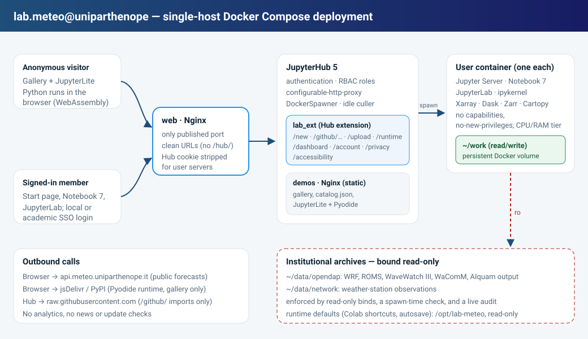
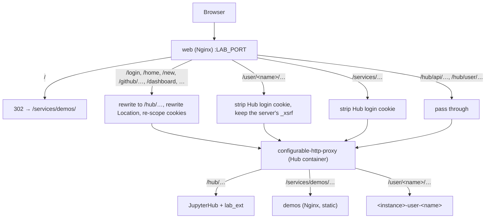

# Architecture

lab.meteo@uniparthenope is a single-host JupyterHub deployment for teaching and research at meteo@uniparthenope.
The reasoning behind each choice is in [Design rationale](design-rationale.md); the user-facing
behaviour is described in [Colab-style workflows](colab-workflows.md).



## Components

| Component | Responsibility |
|---|---|
| JupyterHub 5 | Authentication, RBAC, routing, server lifecycle, Hub database |
| Authenticator | Local accounts (NativeAuthenticator) or academic SSO (Microsoft Entra ID, Google) |
| `lab_ext` Hub extension | Colab-style workspace routes (new notebook, GitHub import, upload, recent files, runtime controls), privacy notice, accessibility statement, *My data* page, platform dashboard |
| DockerSpawner | One isolated, unprivileged container per user |
| Single-user image | Jupyter Server, Notebook 7, JupyterLab, and the weather-analysis Python stack |
| Runtime defaults (`singleuser/`) | Colab shortcuts, completion, autosave; bound read-only at `/opt/lab-meteo` and copied into user settings at start |
| Idle culler | Stops servers idle longer than `LAB_IDLE_TIMEOUT` |
| Public gallery and lab | Static Nginx service: notebook gallery plus JupyterLite with a Pyodide kernel |
| Front proxy (`web`, Nginx) | Sole public entry point; serves Hub pages at clean URLs without `/hub/` |
| ConfigurableHTTPProxy | Inside the Hub container; routes `/user/<username>/` and `/services/demos/` |
| Docker volumes | Persist Hub state and each user's workspace |
| Host bind mounts | Expose templates, operational archives, and station data read-only |
| Custom Hub templates | meteo@uniparthenope identity, accessible layout, sign-in, runtime page |

The extension contributes its pages through the authenticator's `get_handlers` hook, so JupyterHub
itself is not patched and upgrades remain a pinned-version change.

```text
browser ──► :LAB_PORT ──► web (Nginx) ──► hub:8000 (CHP) ──┬─► /hub/…   JupyterHub + lab_ext pages
             /login, /home, /dashboard, … ── rewritten to ───┘
                                                             ├─► /services/demos/  gallery + JupyterLite
                                                             └─► /user/<name>/     <instance>-user-<name> container
                                                           ├─ ~/work            read/write volume
                                                           ├─ ~/data/opendap    read-only model archive
                                                           ├─ ~/data/network    read-only station data
                                                           └─ ~/templates, ~/data/raw, ~/data/curated  read-only
```

## Clean URLs and the front proxy

JupyterHub serves its own pages under a fixed `/hub/` prefix. The `web` service
([`proxy/nginx.conf`](../proxy/nginx.conf)) hides it, and is the only published port; the Hub
container listens on port 8000 inside the Compose network only.

| Public URL | Served by |
|---|---|
| `/` | Redirect to the public gallery `/services/demos/` |
| `/login`, `/logout`, `/home`, `/spawn`, `/token`, `/change-password`, `/signup`, `/authorize`, `/admin`, `/oauth_callback` | JupyterHub, rewritten internally to `/hub/…` |
| `/dashboard`, `/account`, `/privacy`, `/accessibility` | `lab_ext` pages, rewritten to `/hub/…` |
| `/new`, `/github/<owner>/<repo>/blob/<ref>/<path>.ipynb`, `/open?url=`, `/upload` (POST), `/recent`, `/runtime` (POST) | `lab_ext` Colab-style workspace routes (see below) |
| `/api/…` and `/hub/api/…` | Hub REST API (both forms work; JupyterLab and OAuth use the latter) |
| `/hub/user/<name>/…` | Hub "start or wait for server" handler, kept under `/hub/` because `/user/<name>/` is the server itself |
| other `/hub/…` | `GET` redirects to the clean URL; other methods are forwarded |
| `/user/<name>/…`, `/services/…` | Unchanged |

The proxy rewrites `Location` headers and `/hub/` links in Hub HTML. Because Hub pages now live at
the root, it re-scopes the Hub cookies from `/hub/` to `/`. JupyterHub's isolation relies on the
login cookie never reaching user servers, so the proxy removes `jupyterhub-hub-login` from every
request forwarded to `/user/` and `/services/`. When a browser sends both the Hub's and the user
server's `_xsrf` cookie, the proxy keeps only the user server's (the first, longer-path cookie).
Per-path request headers are chosen with `map` blocks, not `proxy_set_header` inside locations,
because a location that sets any proxy header loses the server-level `Upgrade` and `Connection`
headers that kernel WebSockets need.

## Request routing



## Colab-style workspace routes

The `lab_ext.workspace` module adds Colab's notebook workflows to the Hub. Each route requires a
signed-in user and acts only on that user's own server:

| Route | Behaviour |
|---|---|
| `GET /new` | Creates `~/work/UntitledN.ipynb` with one empty code cell and opens it |
| `GET /github/<owner>/<repo>/blob/<ref>/<path>.ipynb` | Copies a public notebook into `~/work/github/<owner>/<repo>/<path>` (unless a copy exists; `?copy=1` forces a new copy) and opens it |
| `GET /open?url=` | Accepts a `github.com` or `raw.githubusercontent.com` link and forwards to the route above |
| `POST /upload` | Stores an uploaded notebook (≤ 25 MB, nbformat ≥ 4) in `~/work/uploads/` and opens it |
| `GET /recent` | JSON list of the fifteen most recently modified notebooks in `~/work` |
| `POST /runtime` | `action=restart` stops and restarts the server; `action=delete` stops it (the container is removed, `~/work` is kept) |

If the runtime is not connected, `GET` routes redirect to `/spawn/<user>?next=<route>`, so the
server starts and the action resumes afterwards. The Hub writes into the server through the
Jupyter Server contents API with an API token that it creates for the request, restricted to the
scope `access:servers!user=<name>`, valid for at most five minutes, and deleted as soon as the
request ends. Notebooks open in the Notebook 7 interface at `/user/<name>/notebooks/<path>`.

## Instances

`LAB_INSTANCE` scopes every Docker object so that several deployments can share a host:

| Object | Default instance `lab` | Other instance, e.g. `labmeteo` |
|---|---|---|
| Hub / gallery / proxy containers | `lab-jupyterhub`, `lab-demos`, `lab-web` | `labmeteo-jupyterhub`, `labmeteo-demos`, `labmeteo-web` |
| Network | `lab-net` | `labmeteo-net` |
| User containers | `jupyter-<user>` | `labmeteo-user-<user>` |
| User volumes | `jupyterhub-user-<user>` | `labmeteo-user-<user>` |
| Images | `lab-demos`, `LAB_SINGLEUSER_IMAGE` | `labmeteo-demos`, `LAB_SINGLEUSER_IMAGE` |

The default instance keeps the historical names so that existing volumes survive upgrades.

## Storage model

| Data | Host source | Container destination | Access |
|---|---|---|---|
| User workspace | `<prefix>-user-{username}` volume | `/home/jovyan/work` | read/write |
| Templates | `LAB_TEMPLATES_HOST` | `/home/jovyan/templates` | read-only |
| Operational model archive | `LAB_OPENDAP_HOST` | `/home/jovyan/data/opendap` | read-only |
| Weather-station network | `LAB_NETWORK_HOST` | `/home/jovyan/data/network` | read-only |
| Raw sensor mirror | `LAB_SENSORS_HOST` | `/home/jovyan/data/raw/sensors` | read-only |
| Raw model mirror | `LAB_MODELS_HOST` | `/home/jovyan/data/raw/models` | read-only |
| Curated data | `LAB_CURATED_HOST` | `/home/jovyan/data/curated` | read-only |
| Hub state | `jupyterhub-data` | `/srv/jupyterhub/data` | Hub only |

The archive layouts are kept unchanged:

```text
opendap/<model>/<domain>/<archive|history>/YYYY/MM/DD/<model>_<domain>_YYYYMMDDZHHMM.nc
network/it.uniparthenope.meteo.wsN/YYYY/MM/DD/it.uniparthenope.meteo.wsN_YYYYMMDDZHH00.csv
```

Models are `wrf5` (WRF), `rms3` (ROMS), `ww33` (WaveWatch III), `wcm3` (WaComM), and `aiq3`
(AIquam); domains are `d01`, `d02`, `d03`, …; `archive` holds normalized products ready for
plotting and `history` the raw model output.

Compose mounts are not inherited by spawned containers. DockerSpawner receives absolute host paths
through environment variables and asks the host Docker daemon to bind them as `read_only_volumes`.
The Hub also mounts the archive and station roots read-only, solely to report their freshness on
the platform dashboard.

## Roles and resources

| Role | Source | Resource tier | Extra permissions |
|---|---|---|---|
| Administrator | `LAB_ADMIN_USERS` or the control panel | researcher (8 GB, 4 CPU) | everything |
| Researcher | group `researchers` | 8 GB, 4 CPU | — |
| Instructor | group `instructors` | 4 GB, 2 CPU | view users and activity, start/stop student servers |
| User | approved account without a role group | 4 GB, 2 CPU | — |
| Student | group `students` | 2 GB, 1 CPU | — |

Limits are configurable (see [Deployment](deployment.md)) and are applied by the Hub's
`pre_spawn_hook` at each server start. See [Identity and roles](identity-and-roles.md).

## Public tier

The gallery at `/services/demos/` is a generated static page that lists the thirty bundled
notebooks and opens each in JupyterLite (`lab/index.html?path=…`). The Nginx container has a
read-only root filesystem and 256 MB / 0.5 CPU / 64-process limits. Notebook execution and uploads
remain in the visitor's browser; the service cannot reach the host, the Docker socket, user volumes,
or the data mounts.
