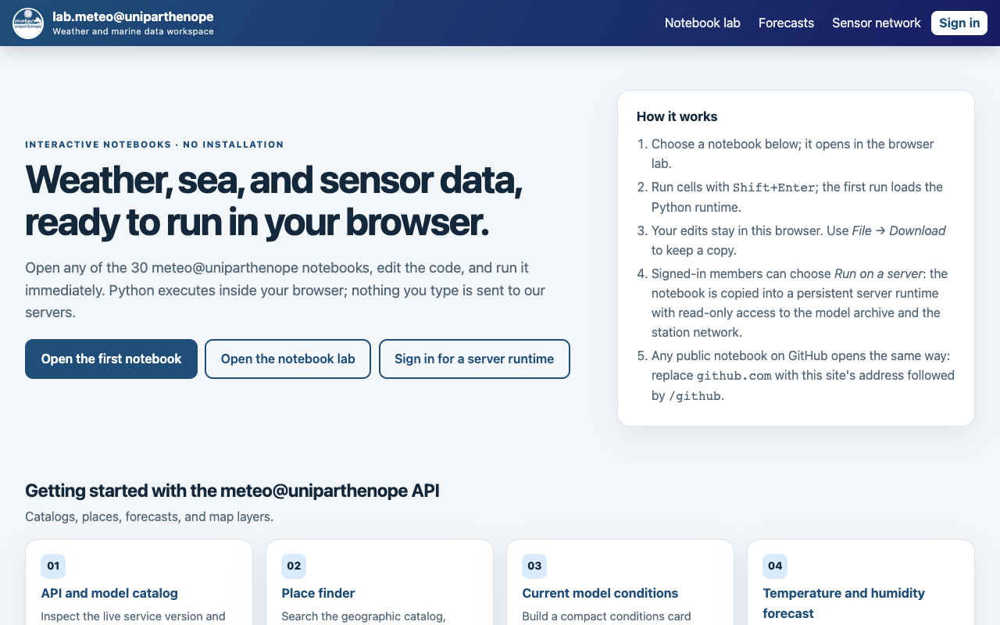
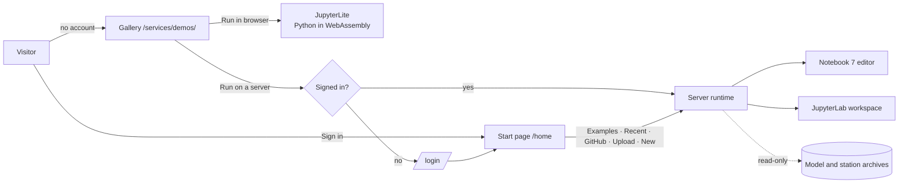
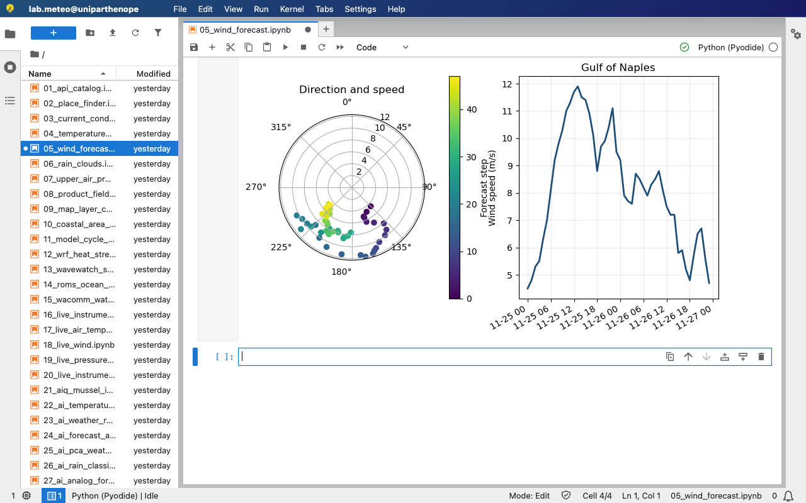
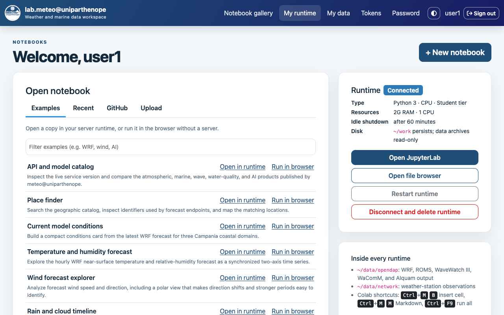
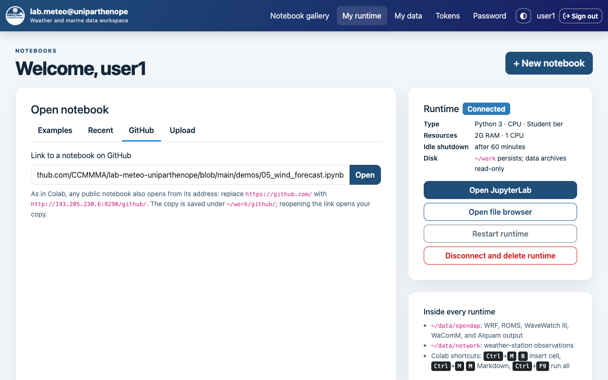
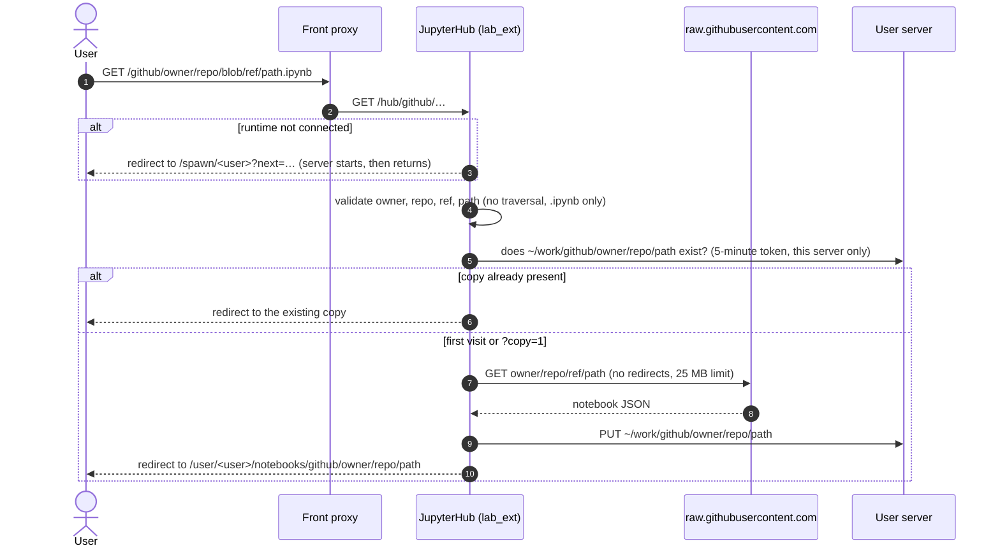
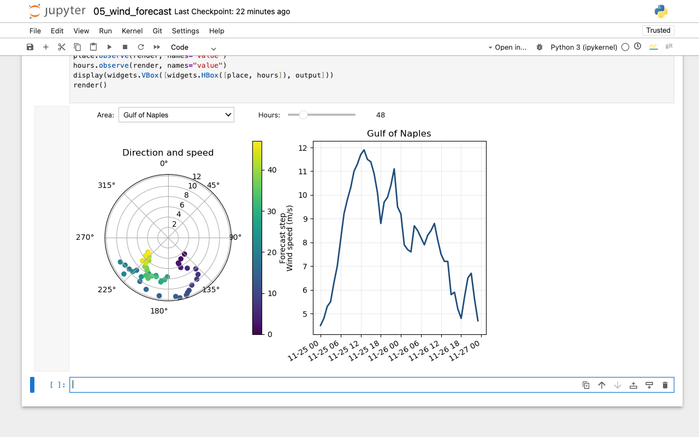
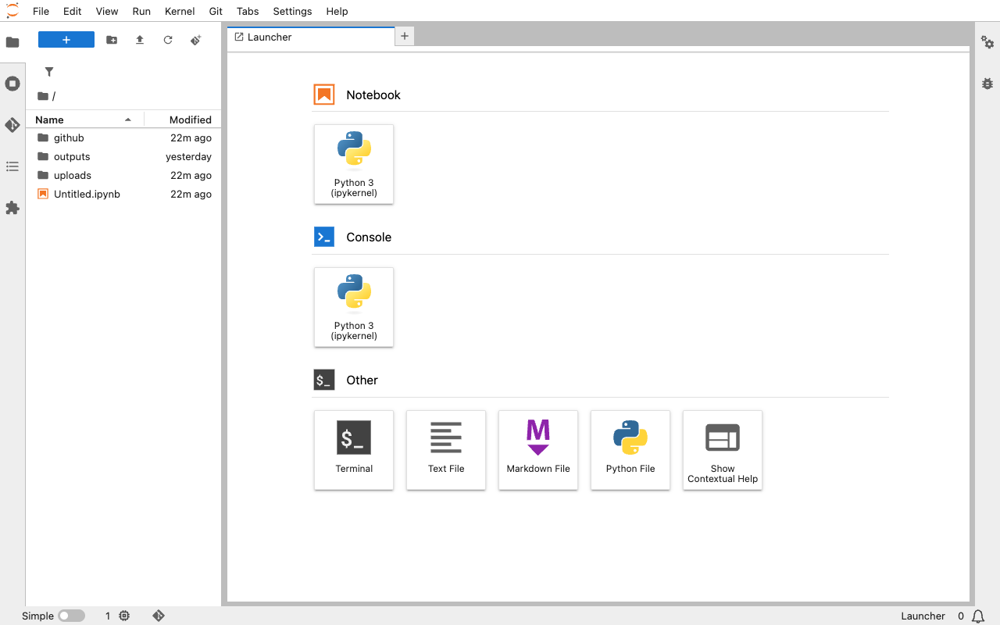
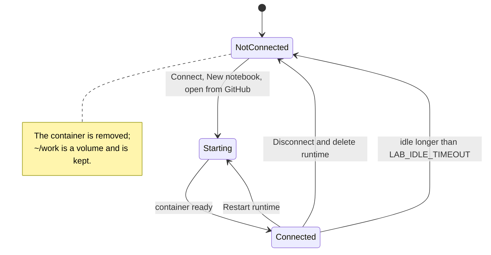

# Colab-style workflows

lab.meteo@uniparthenope reproduces the interaction model of Google Colaboratory on open-source
components (JupyterHub, Jupyter Server, Notebook 7, JupyterLab, JupyterLite) running on University
infrastructure. This guide maps each Colab habit to its lab.meteo counterpart; the design reasoning
is in [Design rationale](design-rationale.md#2-a-colab-style-two-tier-user-experience).

## At a glance

| In Colab | In lab.meteo@uniparthenope | Where |
|---|---|---|
| Welcome notebook without installing anything | Public gallery of thirty notebooks running in the browser (Pyodide/WebAssembly) | `/services/demos/` |
| *Open notebook* dialog: Examples, Recent, GitHub, Upload | Start page with the same four tabs | `/home` |
| *File → New notebook* | **+ New notebook** creates `~/work/UntitledN.ipynb` | `/new` |
| `colab.research.google.com/github/<owner>/<repo>/blob/<ref>/<file>.ipynb` | Same path on this site | `/github/<owner>/<repo>/blob/<ref>/<file>.ipynb` |
| *Open in Colab* badge | *Open in lab.meteo* badge | `/assets/open-in-lab-meteo.svg` |
| Single-notebook editor | Jupyter Notebook 7 interface | `/user/<name>/notebooks/<path>` |
| *Connect*, *Restart runtime*, *Disconnect and delete runtime* | Same buttons on the start page | `/home`, `POST /runtime` |
| *Change runtime type* (RAM, accelerators) | Role-based tiers: student 2 GB / 1 CPU, user and instructor 4 GB / 2 CPU, researcher 8 GB / 4 CPU (defaults) | Runtime card |
| Files saved to Google Drive | Files saved to a persistent workspace volume, `~/work` | JupyterLab file browser |
| Mounting Drive data | Operational archives mounted **read-only** | `~/data/opendap`, `~/data/network` |
| Colab keyboard shortcuts (`Ctrl+M` chords) | Enabled by default | see below |



## Two tiers, one experience



The **browser runtime** needs no account: code runs inside the visitor's browser and never on the
University host. Edits stay in the browser's local storage. Use it to explore the API, models,
live instruments, and AI examples.



The **server runtime** is a personal, isolated container with the full scientific Python stack,
persistent storage, and read-only access to the operational archives. Every gallery card has a
*Run on a server* link that copies the notebook into the server runtime.

## The start page

After signing in, the start page plays the role of Colab's *Open notebook* dialog.



- **Examples** lists the gallery notebooks with *Open in runtime* and *Run in browser* links and a
  filter box.
- **Recent** lists the fifteen most recently modified notebooks in `~/work` (the runtime must be
  connected).
- **GitHub** accepts a link to a notebook on GitHub.
- **Upload** stores an `.ipynb` file of up to 25 MB in `~/work/uploads/` and opens it.



The tabs follow the WAI-ARIA tab pattern: use the arrow keys to move between them.

## Opening notebooks from GitHub

Any public notebook on GitHub opens through a predictable URL, exactly as in Colab:

```text
https://github.com/CCMMMA/lab-meteo-uniparthenope/blob/main/demos/05_wind_forecast.ipynb
                     ↓ replace https://github.com/ with the site address followed by /github/
http://193.205.230.6:8290/github/CCMMMA/lab-meteo-uniparthenope/blob/main/demos/05_wind_forecast.ipynb
```



- The copy lives in `~/work/github/<owner>/<repo>/…`. Reopening the link opens **your copy**, so
  edits are never overwritten; add `?copy=1` to fetch a fresh copy under a new name.
- Only public repositories are supported, and only `.ipynb` files on a branch or tag.
- Add a badge to a README so that readers can open a notebook in one click:

  [](http://193.205.230.6:8290/github/CCMMMA/lab-meteo-uniparthenope/blob/main/demos/05_wind_forecast.ipynb)

  ```markdown
  [](http://193.205.230.6:8290/github/<owner>/<repo>/blob/main/<notebook>.ipynb)
  ```

## The notebook editor

Notebooks open in the Jupyter Notebook 7 interface, the open-source editor closest to Colab: one
document per tab, a menu bar, and a kernel indicator. The *Open in… → JupyterLab* toolbar menu switches to the full
JupyterLab workspace with the file browser, terminals, Git, and Voilà dashboards.





### Keyboard shortcuts

Colab's shortcuts are configured by default, alongside the standard Jupyter ones (`Shift+Enter`
runs a cell and moves on, `Ctrl+Enter` runs it in place, `Alt+Enter` runs it and inserts a new cell).

| Shortcut | Action |
|---|---|
| `Ctrl+M` `B` / `Ctrl+M` `A` | Insert a code cell below / above |
| `Ctrl+M` `D` | Delete the cell |
| `Ctrl+M` `M` / `Ctrl+M` `Y` | Convert to Markdown / code |
| `Ctrl+M` `I` / `Ctrl+M` `.` | Interrupt / restart the kernel |
| `Ctrl+M` `Z` | Undo the last cell action |
| `Ctrl+M` `-` | Split the cell at the cursor |
| `Ctrl+M` `K` / `Ctrl+M` `J` | Move the cell up / down |
| `Ctrl+F9`, `Ctrl+F8`, `Ctrl+F10` | Run all, run all above, run all below |

Other defaults: completion suggestions while typing, automatic closing of brackets, execution times
recorded in cell metadata, autosave every 30 seconds, and no prompts or requests to jupyter.org for
news or updates. They are copied into `~/.jupyter/lab/user-settings` at each start without
overwriting your own choices, and can be changed under *Settings*. The files are in
[`singleuser/`](../singleuser/README.md).

## Runtime lifecycle



As in Colab, deleting the runtime discards the running kernel, installed packages, and anything
outside `~/work`; files in `~/work` persist. Unlike Colab, there is no fixed session cap: an idle
server is stopped after `LAB_IDLE_TIMEOUT` seconds (default 3600).

## Differences from Colab

- **Accelerators:** runtimes are CPU-only; tiers differ in memory and CPU cores.
- **Sharing and comments:** not provided; share notebooks through Git or by downloading them.
- **Accounts:** University single sign-on or approved local accounts, not Google accounts.
- **Data location:** everything is processed on University infrastructure in Italy, and the
  operational archives are available directly, without downloads.
